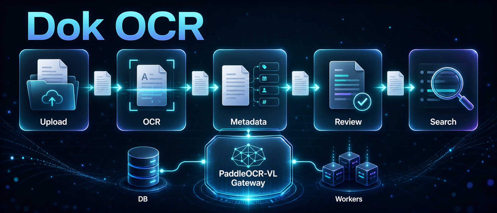

# Dok OCR

Self-hosted document OCR, metadata extraction, review, and full-text search.

Dok OCR keeps every original file, preview, OCR transcript, extracted field, review decision, and processing log in one place. It is built for scanned documents, PDFs, receipts, and invoices, with an English and German web UI.




## Quick start (Docker)

On Linux x86_64 with Docker Engine and the Compose plugin installed:

```bash
curl -fL https://raw.githubusercontent.com/DrBearJew/OCR/main/scripts/install-docker.sh -o install-docker.sh
bash install-docker.sh
```

That gives you the full app using prebuilt images and local CPU **PP-OCRv6**—no source build, GPU, or external model server required.

To enable local AI models with the same installer:

```bash
# PaddleOCR-VL (OCR) + LFM2.5 (metadata) in one ik_llama.cpp container (AVX-512 CPU)
bash install-docker.sh --metadata-runtime unified

# Standard PP-OCRv6 + local LFM2.5 metadata on CPU, NVIDIA, Vulkan, or an external endpoint
bash install-docker.sh --metadata-runtime cpu      # or: cuda, vulkan, external
```

See the [Docker installation guide](docs/INSTALL.md) for hardware requirements, installer flags, HTTPS proxy setup, and troubleshooting.

## How it works

Documents flow through a transparent pipeline:

```text
Upload / Consume folder → OCR (or verified PDF text) → Metadata extraction → Review → Search
```

Everything is organized around three concepts:

```text
Collection → Record → Document
```

- **Collections** define document types (such as incoming invoices, receipts, or custom schemas), title templates, OCR defaults, and custom fields.
- **Records** group related documents under one browsable entry.
- **Documents** hold the original file, page previews, OCR text, extracted fields, processing history, and review status.

## Highlights

- **Flexible OCR:** Local CPU PP-OCRv6 out of the box, PaddleOCR-VL via the unified runtime or an external endpoint, and optional GLM OCR fallback. Searchable PDFs can reuse their embedded text layer when every selected page passes text-quality checks, or force full OCR on demand.
- **Metadata and titles:** Deterministic extraction for titles, dates, correspondents, amounts, document types, and tags, with optional LLM refinement using **LFM2.5-8B-A1B Q5_K_M**. Manual edits can be locked so reprocessing never overwrites them.
- **Review and diagnostics:** Failed, duplicate, and low-confidence documents surface in dedicated queues with per-step event trails and one-click retry, force-OCR, re-extract, and search-rebuild controls.
- **Full-text search:** PostgreSQL search across OCR text, titles, dates, correspondents, tags, and custom collection fields.

## OCR runtimes

| Provider | Best for | Notes |
| --- | --- | --- |
| `ppocrv6` | Everyday CPU-only setups | Default in the Docker installer. Prewarmed in the backend image; no GPU needed. |
| `paddle_vl` | Complex layouts, receipts, and invoices | Included in `--metadata-runtime unified`, or point **Admin → Model Setup** at any compatible endpoint. |
| `glm` | Secondary multimodal OCR | Optional fallback via an external OpenAI-compatible endpoint. |
| `fake` | UI and API development | Default in `app/.env.example` for fast local testing without running OCR. |

## Development setup

To build and run from source (uses `OCR_PROVIDER=fake` by default):

```bash
cd app
cp .env.example .env
# Edit .env to set ADMIN_PASSWORD and SECRET_KEY
docker compose up --build
```

Then open the UI at <http://localhost:3001> and API docs at <http://localhost:8001/docs>.

### Custom model-runtime overlay

If you maintain your own multi-model gateway image instead of using the prebuilt installer, set `DOKOCR_MODEL_RUNTIME_IMAGE` in `app/.env`, populate the `/models` volume, and run:

```bash
cd app
docker compose -f docker-compose.yml -f docker-compose.smart.yml up -d
python ../scripts/doctor-smart-runtime.py --base-url http://localhost:8092/v1
```

The `model-runtime` gateway exposes `paddleocr-vl`, `metadata` (LFM2.5-8B-A1B), optional `metadata-gemma`, and optional `glm`. Legacy `QWEN_*` environment variable names remain supported for compatibility, even though the metadata model is LFM2.5.

If you already run an OpenAI-compatible inference server, skip the overlay and configure its URL in **Admin → Model Setup**.

> [!IMPORTANT]
> Dok OCR stores sensitive documents. Change default credentials, put the app behind HTTPS on a reverse proxy, and back up both PostgreSQL and the document storage volume.

## Documentation

- [Docker installation guide](docs/INSTALL.md) — prebuilt setup, CPU/GPU/unified options, security, and upgrades.
- [Application & developer guide](app/README.md) — architecture, source builds, tests, CLI recovery, and troubleshooting.
- [Unified ik runtime](deploy/paddle-ik/README.md) — single-container PaddleOCR-VL + LFM2.5 runtime.
- [Metadata runtime](deploy/metadata/README.md) — LFM2.5 CPU/CUDA/Vulkan images, GPU controls, and JSON-schema patch.
- [Maintainer model-runtime recipe](deploy/model-runtime/README.md) — custom multi-model `llama-swap` container contract.
- [Native GLM-OCR port](deploy/glm/README.md) — optional CPU GLM-OCR patch for `ik_llama.cpp`.
- [OpenVINO sidecar reference](deploy/paddlevl/README-llama-swap-openvino-sidecar.md) — legacy host/sidecar setup for PaddleOCR-VL.
