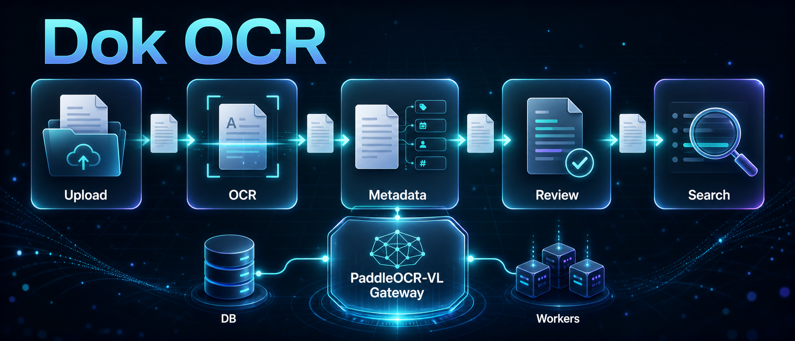

# Dok OCR

A self-hosted app for OCR, metadata extraction, review, and search across document collections. It keeps source files, OCR text, metadata, processing history, and review state together.

> **Install for use:** [Docker installation guide](docs/INSTALL.md) uses prebuilt Linux x86_64 images and real CPU PP-OCRv6 by default. Optional metadata AI is included with `--metadata`.

With Docker Engine and the Compose plugin already installed:

```bash
curl -fL https://raw.githubusercontent.com/DrBearJew/OCR/main/scripts/install-docker.sh -o install-docker.sh && bash install-docker.sh
```

No source build or manual model setup is needed. The installer generates credentials and prints their private file location. See the guide for requirements, security and the optional AI download.




---

## What Dok OCR is

Dok OCR is a self-hosted document processing app, not just an OCR script. It gives you a full workflow around scanned documents, screenshots, PDFs, receipts, invoices, and mixed document batches.

It is built around a simple model:

```txt
Collection → Record → Document
```

Each document can keep its original file, preview, OCR text, extracted metadata, title, review state, processing events, retry history, and search index state.

> [!NOTE]
> Dok OCR can use PaddleOCR-VL and PP-OCRv6, but it is not the PaddleOCR toolkit itself. It is the private document workflow layer around OCR providers, metadata extraction, review, and search.

---

## 🚀 Key Features

### Document OCR

- PaddleOCR-VL uses a compatible multimodal endpoint; failures remain visible for retry or review.
- PP-OCRv6 provides a local CPU option.
- The optional smart PaddleOCR-VL Compose runtime remains a separate manual operator path with prepared image and model assets; it is not part of the prebuilt CPU install.

### Metadata and titles

- **Deterministic extraction:** titles, dates, correspondents, document types, tags, and collection fields.
- **Optional metadata refinement:** OpenAI-compatible text reasoning. The documented production metadata route is LFM2.5-8B-A1B Q5_K_M; legacy `qwen` setting names and aliases are compatibility wiring, not the model identity.
- **Field locking:** manual corrections can be preserved during reprocessing.

### Review and processing history

- **Failure queues:** failed, duplicate, incomplete, and review-needed documents stay visible.
- **Per-document events:** validation, storage, OCR, metadata, indexing, and retry events are traceable.
- **Manual controls:** rerun OCR, force OCR, re-extract metadata, preview extraction, or rebuild search.

### Search

- **PostgreSQL full-text search:** OCR text, titles, metadata, records, and collections.
- **Collection model:** per-collection OCR defaults, schema rules, title rules, and search defaults.
- **German/English UI:** app shell and core workflows are localized for English and German users.

---

## Processing flow

**Upload → OCR or verified PDF text → metadata → review → search.** Processing history and manual retry controls remain available in the app.

---

## ⚙️ Choose your runtime

| Mode | Best for | Default provider | Notes |
| --- | --- | --- | --- |
| **Fake** | UI development and smoke tests | `fake` | No real OCR. Fastest way to test the app shell. |
| **Local** | Small machines, CPU-only OCR | `ppocrv6` | No GPU required. PP-OCRv6 models are prewarmed in the backend image. |
| **Smart** | Multimodal document OCR | `paddle_vl` | Uses a compatible PaddleOCR-VL endpoint. The optional Compose runtime requires operator-supplied image and model assets. |
| **Fallback** | Legacy multimodal OCR | `glm` | Kept as a secondary OCR path. |

---

## ⚡ Development quick start: source-built app (fake OCR by default)

This path builds the source tree and uses `OCR_PROVIDER=fake` from `.env.example`; it is for development, not the prebuilt user install above. To start with real PP-OCRv6 without building images, use the [Docker installation guide](docs/INSTALL.md).

```bash
cd app
cp .env.example .env
# edit .env: change ADMIN_PASSWORD and SECRET_KEY
docker compose up --build
```

Open:

- UI: <http://localhost:3001>
- API docs: <http://localhost:8001/docs>

Prerequisites: Docker Compose and outbound network access for container images, Python packages, and PP-OCRv6 model downloads.

> [!IMPORTANT]
> Dok OCR handles sensitive documents. Run it only on trusted infrastructure, change default credentials, configure HTTPS at your reverse proxy, and back up PostgreSQL plus the file volume.

---

## Optional smart model runtime

The Compose overlay is an advanced operator path, not the basic quickstart. Before using it, set `DOKOCR_MODEL_RUNTIME_IMAGE` in `app/.env` to an image you have prepared and tested, and provision its required model files in the runtime volume. The repository's `deploy/model-runtime/` files are maintainer/reference scaffolding: they are not a released image, do not define a public default tag, and do not download model files on first start.

```bash
cd app
# Set DOKOCR_MODEL_RUNTIME_IMAGE in .env to your prepared, tested image reference.
docker compose -f docker-compose.yml -f docker-compose.smart.yml up -d
python ../scripts/doctor-smart-runtime.py --base-url http://localhost:8092/v1
```

The overlay routes compatible endpoints for PaddleOCR-VL (`paddleocr-vl`), metadata (`metadata`), and optional GLM OCR (`glm`). Metadata's production model is LFM2.5-8B-A1B Q5_K_M; `metadata-gemma` is an optional rollback route. Details and build prerequisites: [`deploy/metadata/README.md`](deploy/metadata/README.md), [`deploy/model-runtime/`](deploy/model-runtime/), and the [advanced PaddleOCR-VL sidecar guide](deploy/paddlevl/README-llama-swap-openvino-sidecar.md).

If you already operate a compatible endpoint, configure it in **Admin → Model Setup** instead of using the Compose overlay.


---

## Model configuration

Configure external OCR and metadata endpoints through **Admin → Model Setup**. The advanced Compose path retains legacy `QWEN_*` setting names, but model id `metadata` identifies the production LFM2.5 route. Thinking uses a 4096-token completion cap and `--reasoning-budget 3072`, reserving 1024 tokens for final JSON; the metadata timeout is at least 240 seconds while the OCR timeout remains 120 seconds. See [`deploy/metadata/README.md`](deploy/metadata/README.md) for the pinned runtime and schema patch. The backend owns prompts, JSON-schema requests, response cleanup, PDF text-layer checks, and metadata parsing.

---

## Current boundaries

- The source-based app quickstart defaults to `fake`; `ppocrv6` can be selected manually. The standalone Docker install defaults to real local PP-OCRv6.
- The smart Compose overlay is a separate manual PaddleOCR-VL/operator path. It needs an operator-supplied, tested image and model files and does not download them on first start.
- A short synthetic image can expose a known single-image PaddleOCR-VL adapter issue where instruction text is appended to OCR output. A raw native task-cue smoke returned the expected test text, but that does not verify the full app adapter path.
- In redo mode, searchable PDFs may use the embedded text layer only when every selected page passes the configured usable-text checks. Force mode always invokes the selected OCR provider.

For operations, limitations, tests, and troubleshooting, see [`app/README.md`](app/README.md).

---

## Documentation

- [`docs/INSTALL.md`](docs/INSTALL.md): prebuilt Docker install, configuration, security, lifecycle, and troubleshooting.
- [`app/README.md`](app/README.md): source-based development setup, runtime modes, lifecycle, operations, tests, security, and troubleshooting.
- [`deploy/metadata/README.md`](deploy/metadata/README.md): production metadata model/runtime details and verification.
- [`deploy/glm/README.md`](deploy/glm/README.md): optional, locally verified native GLM-OCR ik source port; not the default installer.
- [`deploy/model-runtime/`](deploy/model-runtime/): maintainer/reference packaging contract, not a released turnkey image.
- [`deploy/paddlevl/README-llama-swap-openvino-sidecar.md`](deploy/paddlevl/README-llama-swap-openvino-sidecar.md): advanced PaddleOCR-VL runtime operations.

